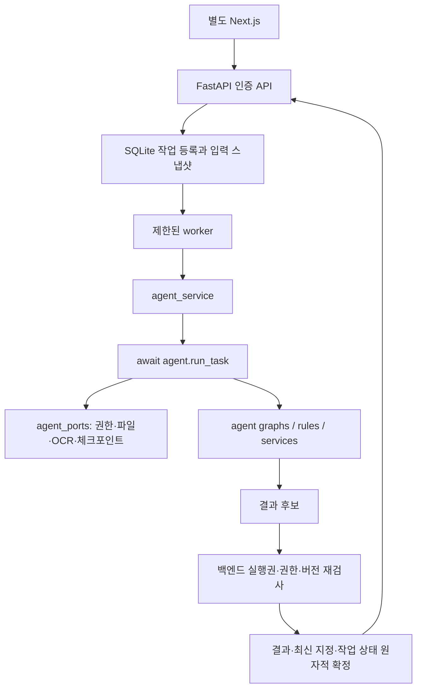

# 통합 구조

1차 검토 작업실은 `app/review_*`의 인증·SQLite·공통 worker와 `agent/review`의 내부 Python 함수로 연결한다. 별도 개발 서버/JSON LocalStore는 사용하지 않는다. 상세 API·확인·원본 구간·계산 연결 경계는 [검토 작업실 계약](REVIEW_WORKSPACE.md)을 참조한다. 기존 `run_task`, 공개 계약 1.1, 원본/파생 PDF와 보고서 출처 기록은 유지한다.

## 폴더와 역할

```text
devmerge/
  app/
    main.py                  FastAPI 시작/설정 주입/worker 수명/오류
    config.py                백엔드 환경설정 → AgentSettings
    db.py                    기존 계정·자료·사례·배분 SQLite
    integration_store.py     비교 묶음·작업·스냅샷·결과·OCR·산출물 저장
    security.py              로그인/사용자별 자원 소유권
    worker.py                로컬 읽기 등록 + 제한된 작업 소비
    engine.py                기존 URL용 결과 조회·입력 무효화 (계산식 없음)
    agent_service.py         선점/원문 읽기/run_task/최종 확정
    agent_mapping.py         확인값·원문 의미·배분 → 공개 입력/결과
    agent_ports.py           DB·파일 기반 AgentPorts
    agent_review.py          A/B/수기/보류 확인 및 불변 이력
    ai.py                    자유 채팅용 내부 모델 서비스
    routers/                 인증·자료함·사례·묶음·작업·결과·다운로드 API
  agent/
    schemas/public/          공개 계약 1.1 (사례 있는 1.0 호환)
    ports/ graphs/ rules/ services/ providers/
    dev/                     개발 회귀 전용, 운영 import 없음
    tests/                   기존 agent 회귀
  tests/backend/             백엔드 회귀/이전 계약 검토
  tests/integration/         실제 SQLite·파일·run_task 통합
  assets/fonts/              배포용 한글 폰트/OFL 라이선스
  docs/ scripts/
  pyproject.toml uv.lock .env.example README.md
```

`integration_store.py`와 `agent_review.py`는 저장·확인 로직이 실행 순서 파일에 섞이지 않도록 추가한 작은 역할 분리다. 계산·근거 규칙을 구현하지 않는다. 기존 `agent/dev`의 후보 선택·비교 대상 검증은 `agent/services`로 옮기고 개발 import는 호환 래퍼를 사용한다.

## 호출



원문 읽기 `recognize_document`는 `run_task(extract_document)`와 별개다. 읽기 결과를 먼저 DB에 저장한다. A는 저장 OCR ID/버전/해시로 연결된 텍스트만 사용한다. B는 같은 읽기·A 기준의 선택 항목을 별도 처리한다. JPEG/PNG 원본은 유지하고 파생 PDF의 원본 해시/파생 해시를 저장한다.

## 저장 관계

사용자 → 사업장 → 급여기간 사례 → 비교 묶음 → 입력 스냅샷 → 실행 작업 → 결과 이력.

- `documents`: 사업장 원본 자료함. 사례 없는 추출은 context.case_id=null, schema_version=1.1로 처리한다. 가짜 사례를 만들지 않는다.
- `document_links`: 사례와 원본의 접근 연결. 단조 증가 ID와 link_version으로 연결 철회·재연결 시 과거 권한이 부활하지 않게 한다.
- `comparison_groups`, `group_documents`, `group_confirmations`: 문서 선택·확인값·버전·최신 결과를 묶음별로 분리한다. 사례 생성 시 `default-{case_id}`를 만든다.
- `payment_transactions`, `allocations`: 거래 및 원금 배분은 사례 단위다. 묶음은 `selected_transaction_ids`만 선택하므로 같은 기간의 대안 묶음이 배분을 다시 소비하지 않는다.
- `document_ocr`, `extraction_candidates`, `document_confirmations`: 읽기, A/B 제안, 사용자 확인을 별도 이력으로 보존한다. 재추출이 사용자 수정값을 덮어쓰지 않는다.
- `agent_snapshots`: agent 규약의 snapshot_hash로 고정하며 UPDATE를 DB 트리거로 금지한다. 보고서용 사업장 이름·원본 이름도 display_json에 고정한다.
- `agent_jobs`: 요청 payload/스냅샷/묶음·문서 범위/실행 ID/실행 토큰 해시/상태. 키는 사용자 단위로 중복 방지한다.
- `agent_checkpoints`: 같은 논리 작업의 fingerprint·완료 노드·누적 호출 예산. 재시작/재시도에서도 예산을 감소시키지 않는다.
- `agent_results`: 백엔드가 ID·묶음별 결과 버전·freshness를 부여한다. agent 계산 내용의 result_hash는 그대로 검증한다.
- `agent_artifacts`: 생성 바이트는 STAGED 후 결과 확정 시 PUBLISHED. 실패 산출물은 다운로드할 수 없다.

## 트랜잭션 경계

1. 요청의 짧은 write transaction에서 확인 입력을 불변 snapshot/payload로 고정한다.
2. worker가 짧은 write transaction으로 작업을 선점하고 새 run_id/비밀 토큰을 발급한다.
3. 연결을 닫고 OCR/AI/`await run_task`를 실행한다. Ports는 필요한 순간만 짧은 DB 작업을 수행한다.
4. 새 write transaction에서 실행권·취소·사용자/사업장/사례/묶음 삭제·원본/연결 버전·입력/묶음 버전을 검사한다.
5. 내용만 바뀌면 옛 입력 결과를 stale로 보존하되 latest_result_id를 바꾸지 않는다. 삭제·접근 철회·실행권 상실은 적용을 거부한다.
6. 결과 저장·latest 지정·작업 상태·산출물 게시를 함께 commit한다.

스냅샷을 등록 시점에 고정하는 것은 요청이 실행 대기 중 수정되어도 요청 당시 입력을 재현하기 위한 선택이다. 선점 시에는 그 고정 snapshot_id를 해당 실행에 묶는다. 단일 프로세스 재시작은 RUNNING 작업을 새 실행권으로 복구한다. 다중 프로세스/분산 lease는 이번 배포 범위가 아니다.

## 기존 API 조정

`/cases/{id}/comparisons`는 결과 이력으로 유지한다. 묶음 관리는 `/cases/{id}/comparison-groups`다. 기존 자동 재계산을 명시적 확인 후 analyze로 바꾸었으며, 기존 prototype 숫자 입력으로 부족한 임금 조건을 임의 생성하지 않는다. 반환되는 agent 금액은 decimal string이며 비교의 부호는 lhs-rhs다. 옛 숫자형 ResultsDTO를 새 결과에 적용하지 않는다.

보고서는 확정 agent 결과의 `/agent-results/{id}/reports`와 `agent/services/reports.py`를 사용한다. 사용하지 않는 이전 보고서 구현·라우터와 최초 복사용 스크립트는 정리했다. 이전 HTTP AIAdapter의 추출 및 고정 mock은 제거했으며 자유 채팅은 외부 모델을 직접 호출한다.
